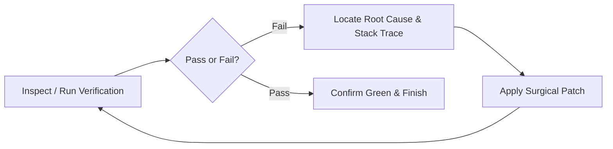

# AGENTS.md — Autonomous Agent Operating Directives

## 1. Project Context & Environment
- **Project**: Farmer Trades (Direct Farmer-to-Buyer Marketplace & Agri-Services)
- **Backend**: FastAPI with SQLite (`backend/agro_trades.db`), SQLAlchemy (`backend/db_models.py`), endpoints in `backend/routes.py`.
- **Frontend**: Vite + React + TypeScript in `frontend/`.
- **Active Dev Servers**:
  - Backend: `uvicorn main:app --reload` on port 8000
  - Frontend: `npm run dev` on port 5173

---

## 2. GSD (Get Shit Done) Protocol
- **Pragmatic Delivery**: Act immediately without conversational delays or unnecessary confirmation prompts for straightforward tasks.
- **Complete Solutions**: Never generate placeholder code or stubbed mocks. Implement complete functionality.
- **Architectural Harmony**: Follow established patterns for routing, styling, state management, and error handling.
- **Verification Gate**: Before marking any task complete, verify via builds and runtime checks.

---

## 3. Ralph Loop (Autonomous Feedback & Healing)
When given a bug, test failure, or complex feature:

- Run `scripts/ralph_loop.bat` to verify both frontend TypeScript compilation and backend Python integrity in a single pass.
- Autonomous loop: Continue iterative debugging until all checks report green.

---

## 4. CodeRabbit Review Compatibility
All code must adhere to automated review standards:
- **Security**: Never hardcode credentials, validate auth tokens, verify payment webhooks.
- **Reliability**: Guard against null/undefined, handle API failure states with user-friendly alerts.
- **Performance**: Avoid unnecessary component re-renders, optimize database queries.
- **Type Safety**: Maintain strict TypeScript typing in frontend and Pydantic models in backend.
